<!-- =================================================== -->
<!-- NEON FUTURISTIC HERO BANNER                        -->
<!-- =================================================== -->
<picture>
  <source media="(prefers-reduced-motion: reduce)" srcset="./assets/hero-static.svg">
  
</picture>

 

<!-- =================================================== -->
<!-- SECTION 01: SYS.CORE // EXECUTIVE OVERVIEW         -->
<!-- =================================================== -->

  

### ⚡ Cyber Identity &amp; Engineering Focus

> **Full Stack Developer** and **Master in Next.js &amp; JavaScript**, architecting high-performance, responsive, and visually electric web applications. Specializing in modern JavaScript/TypeScript ecosystems, App Router architectures, dynamic server-side rendering, and scalable backend integrations.

* **Primary Stack Core**: **Next.js** (App Router, Server Actions, SSR/SSG), **JavaScript (ESNext)**, **TypeScript**, **React**, alongside **Python** and **Django** backend systems.
* **Engineering Standard**: Crafting bleeding-edge digital experiences with laser precision—combining seamless user interfaces with resilient, low-latency API architectures.
* **Specialized Capabilities**: Next.js full-stack orchestration, asynchronous JavaScript architectures, state management, RESTful microservices, and database modeling with SQL &amp; NoSQL.

---

<!-- =================================================== -->
<!-- SECTION 02: TECH.MATRIX // FULL STACK ARSENAL       -->
<!-- =================================================== -->

  

| Cyber Domain | Production Technologies &amp; Frameworks |
| :--- | :--- |
| **Primary Mastery** | `Next.js` • `JavaScript (ESNext)` • `React.js` • `TypeScript` |
| **Backend &amp; APIs** | `Python` • `Django` • `Flask` • `RESTful APIs` • `Node.js` • `PHP` |
| **Data &amp; Persistence** | `SQL` • `MySQL` • `MongoDB` • `PostgreSQL` • `SQLite` • `NoSQL` |
| **UI, Styling &amp; Design** | `Tailwind CSS` • `HTML5 / CSS3` • `Figma UI/UX` • `Responsive Layouts` |
| **DevOps &amp; Tooling** | `Git` • `GitHub` • `VS Code` • `Postman` • `Vercel` • `Power BI` |

 

<!-- Neon Styled Badges -->

---

<!-- =================================================== -->
<!-- SECTION 03: DEPLOYED.REPOS // FEATURED CODE         -->
<!-- =================================================== -->

  

### 01. Campus Lost &amp; Found Full Stack Portal
* **Architecture**: JavaScript • Django / PHP • MySQL • Responsive Figma UI/UX
* **Live Repositories**: [`shaniraj4587/Lost_found_using_Django`](https://github.com/shaniraj4587/Lost_found_using_Django) &bull; [`shaniraj4587/Lost-Found-Portal`](https://github.com/shaniraj4587/Lost-Found-Portal)
* **Engineering Scope**: Centralized digital recovery engine engineered for campus-wide item tracking. Features dynamic client-side filtering, reactive claim verification lifecycles, role-based access control, and a modern responsive user interface designed in Figma.

### 02. CueFlow &amp; Exam Protector Systems
* **Architecture**: TypeScript • Next.js / React • Modern JavaScript Ecosystem
* **Live Repositories**: [`shaniraj4587/CueFlow`](https://github.com/shaniraj4587/CueFlow) &bull; [`shaniraj4587/exam-protector`](https://github.com/shaniraj4587/exam-protector)
* **Engineering Scope**: High-concurrency client-server web applications engineered with strictly typed TypeScript and modern JavaScript runtimes, optimizing real-time state synchronization, DOM lifecycle management, and frontend security protocols.

### 03. Data Visualizer &amp; Practical Analysis Suite
* **Architecture**: Python • Pandas • Matplotlib • Jupyter Notebook
* **Live Repository**: [`shaniraj4587/DataVisualizationPracticle`](https://github.com/shaniraj4587/DataVisualizationPracticle)
* **Engineering Scope**: Automated analytical pipeline processing structured CSV datasets, computing descriptive statistics, and generating real-time visual trend distribution models.

### 04. Modular Flask Publishing Engine
* **Architecture**: Python • Flask • Jinja2 • RESTful Architecture
* **Live Repository**: [`shaniraj4587/Flask-blog-site`](https://github.com/shaniraj4587/Flask-blog-site)
* **Engineering Scope**: Lightweight modular web architecture with isolated routing modules, secure cookie-session handling, and structured CRUD data persistence.

---

<!-- =================================================== -->
<!-- SECTION 04: TELEMETRY // REAL-TIME METRICS & ACTIVITY-->
<!-- =================================================== -->

  

#### ✦ Annual Contribution Heatmap (Verified Live Data)

  

#### ✦ Verified GitHub Metrics &amp; Consistency Telemetry

  
  &nbsp;&nbsp;
  

  

---

<!-- =================================================== -->
<!-- SECTION 05: NETWORK // CYBER COMM-LINKS             -->
<!-- =================================================== -->

  

&nbsp;

&nbsp;

&nbsp;

&nbsp;

&nbsp;

 

<!-- =================================================== -->
<!-- SECTION 06: FUTURISTIC FOOTER                       -->
<!-- =================================================== -->

  

